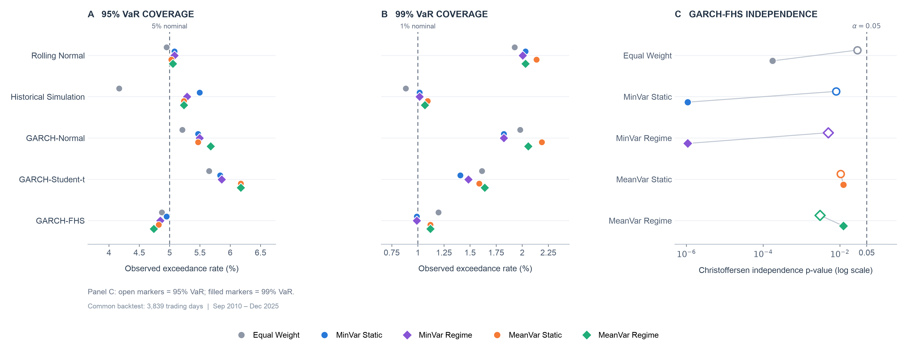
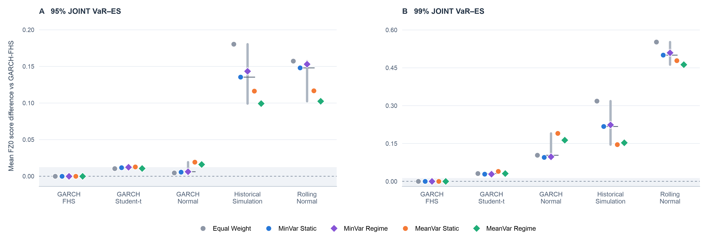
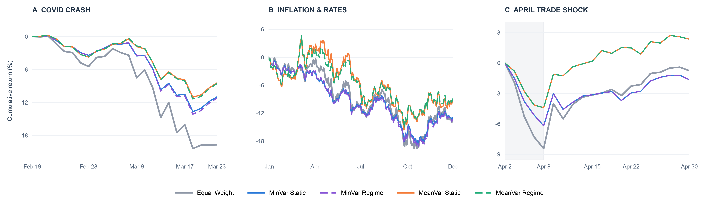
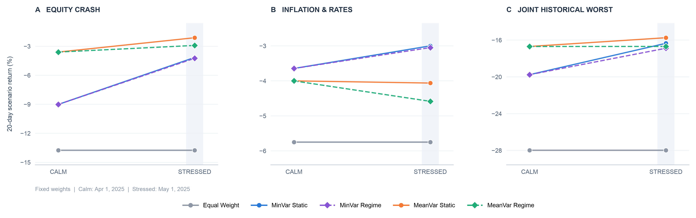
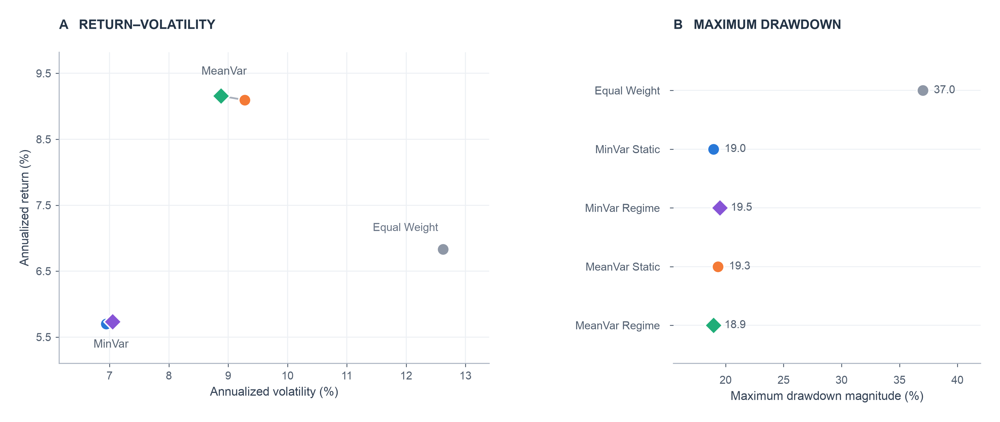

# Portfolio Risk Assessment and Model Validation

*An Independent Evaluation of Five Portfolio Strategies*

**Research report**  
**Repository:** [DINGMINZHAO/portfolio-risk-validation](https://github.com/DINGMINZHAO/portfolio-risk-validation)  
**Source portfolio project:** [AhmadMujtaba200210/qpm-project](https://github.com/AhmadMujtaba200210/qpm-project)

---

# 1. Introduction

Portfolio optimization is the first step in portfolio management. The resulting portfolios should then undergo risk assessment. This project uses the portfolio allocations from the open-source [qpm-project](https://github.com/AhmadMujtaba200210/qpm-project) on GitHub to conduct an independent quantitative risk assessment. The analysis covers portfolio risk measurement, Value at Risk (VaR) and Expected Shortfall (ES) backtesting, and historical and hypothetical stress testing.

The assessment covers five portfolio strategies: Equal Weight, Static Minimum Variance, Regime-Based Minimum Variance, Static Mean-Variance, and Regime-Based Mean-Variance. All five portfolios use the same eight ETFs covering equities, bonds, gold, real estate, and commodities. This research reconstructs daily portfolio returns using the asset returns and portfolio weights from the source project. These returns provide a consistent basis for comparing the risk profiles of the five strategies.

This research compares annualized returns, volatility, and maximum drawdown across the five portfolios. I use five risk models to estimate one-day-ahead Value at Risk (VaR) and Expected Shortfall (ES), and evaluate their reliability through statistical backtesting and diagnostic tests. I also conduct historical and hypothetical stress tests to assess portfolio losses under different market conditions.

This research aims to clarify whether portfolio optimization consistently reduces risk across different risk measures and market conditions. The research uses Equal Weight as the benchmark for evaluating optimized portfolios. I also compare Static and Regime-Based strategies to assess the additional protection from regime-based constraints. The analysis identifies the benefits and limitations of each strategy.

# 2. Data and Portfolio Strategies

## 2.1 Asset Universe and Data Sources

The portfolio universe consists of eight exchange-traded funds (ETFs): SPY (US equities), EFA (developed-market equities), EEM (emerging-market equities), TLT (long-term US Treasury bonds), IEF (intermediate-term US Treasury bonds), GLD (gold), VNQ (US real estate), and DBC (commodities). The asset data and portfolio weights come from the open-source qpm-project on GitHub. This research uses these data to evaluate five portfolio strategies across the same asset universe.

**Table 1. Asset Universe**

| Ticker | Asset Class | Exposure |
|:---|:---|:---|
| SPY | Equity | US large-cap equities |
| EFA | Equity | Developed markets (EAFE) |
| EEM | Equity | Emerging markets |
| TLT | Fixed Income | US Treasuries, 20+ years |
| IEF | Fixed Income | US Treasuries, 7–10 years |
| GLD | Gold | Gold bullion |
| VNQ | Real Estate | US real estate equities |
| DBC | Commodities | Broad commodity futures |

## 2.2 Portfolio Strategies

The source project constructs five portfolio strategies using the same eight ETFs. Table 2 summarizes their objectives and allocation rules. All five strategies rebalance over time.

**Table 2. Portfolio Strategies**

| Strategy | Objective | Allocation Rule |
|:---|:---|:---|
| Equal Weight | Equal allocation across assets | 12.5% per ETF |
| MinVar Static | Minimize portfolio variance | Fixed constraints |
| MinVar Regime | Minimize portfolio variance | Regime-dependent constraints |
| MeanVar Static | Balance expected return and risk | Fixed constraints |
| MeanVar Regime | Balance expected return and risk | Regime-dependent constraints |

*Note: Static strategies maintain fixed allocation constraints, not fixed portfolio weights. Regime-Based strategies adjust their constraints according to market conditions. In the source implementation, the MeanVar strategies maximize estimated portfolio return divided by volatility, subject to allocation constraints.*

## 2.3 Return Reconstruction

This research calculates daily arithmetic returns from the adjusted closing prices of the eight ETFs. I use the most recent portfolio weights from a prior date to calculate each strategy's daily return. The reconstructed returns are then compared with the original backtest results from the source project to verify consistency.

## 2.4 Data Validation and Sample Period

This research checks the input data for missing values, duplicate dates, and invalid returns. I also verify the portfolio weight sums and their timing to avoid look-ahead bias. The reconstructed returns are compared with the original backtest data.

The common VaR and ES backtesting period runs from September 3, 2010, to December 8, 2025, covering 3,839 trading days. All five portfolios and five risk models use the same evaluation dates. The full-sample portfolio analysis runs from September 1, 2006, to December 8, 2025, with 4,847 daily observations.

# 3. Risk Assessment Framework

## 3.1 Portfolio Risk Measures

This research evaluates portfolio performance using annualized return, annualized volatility, and maximum drawdown. Annualized return measures compounded portfolio growth, while annualized volatility measures the variability of daily returns. Maximum drawdown measures the largest decline from a previous portfolio value peak. I use 252 trading days for annualization. Together, these metrics provide a baseline comparison of the five portfolio strategies.

**Table 3. Portfolio Risk Measures**

| Metric | Calculation |
|:---|:---|
| Annualized Return | $\left[\prod_{t=1}^{T}(1+r_t)\right]^{252/T}-1$ |
| Annualized Volatility | $\sigma_d\sqrt{252}$ |
| Maximum Drawdown | $\min_t\left(\frac{W_t}{\max_{s\le t}W_s}-1\right)$ |

Here, $r_t$ is the daily portfolio return, $\sigma_d$ is the sample standard deviation of daily returns, and $W_t$ is the cumulative portfolio value.

## 3.2 VaR and ES Forecasting

I estimate one-day-ahead Value at Risk (VaR) and Expected Shortfall (ES) at the 95% and 99% confidence levels. VaR estimates a loss threshold, while ES estimates the average loss beyond that threshold. This research compares five forecasting models: Rolling Normal, Historical Simulation, GARCH-Normal, GARCH-Student-t, and GARCH-Filtered Historical Simulation (GARCH-FHS).

**Table 4. VaR and ES Forecasting Models**

| Model | Distribution / Method | Estimation Window |
|:---|:---|:---|
| Rolling Normal | Normal distribution | 252 days |
| Historical Simulation | Empirical return distribution | 1,008 days |
| GARCH-Normal | GARCH(1,1), Normal innovations | 1,008 days |
| GARCH-Student-t | GARCH(1,1), Student-t innovations | 1,008 days |
| GARCH-FHS | GARCH volatility and empirical standardized residuals | 1,008 days |

The Rolling Normal model estimates the mean and volatility from the previous 252 trading days. Historical Simulation uses the empirical distribution of returns from the previous 1,008 trading days. The three GARCH-based models use a 1,008-day estimation window. I refit their volatility model parameters every 21 trading days and update volatility forecasts daily. GARCH-FHS combines the volatility forecasts with an empirical distribution of standardized residuals. All forecasts use information available before the prediction date.

## 3.3 Risk Model Validation

This research evaluates VaR forecasts by comparing predicted loss thresholds with realized portfolio losses. I use the Kupiec test to assess unconditional coverage and the Christoffersen tests to examine exceedance independence and conditional coverage. Additional diagnostics include exceedance timing, standardized residuals, and probability integral transforms (PIT). For ES, I examine exceedance residuals and compare joint VaR–ES forecasts using the FZ0 scoring function. These tests assess forecast reliability across the five models and five portfolios.

## 3.4 Historical and Hypothetical Stress Testing

### 3.4.1 Historical Stress Testing

This research examines portfolio performance during three market stress periods: the COVID-19 crash in 2020, the inflation and interest rate shocks in 2022, and the trade policy shock in April 2025. I calculate cumulative returns, drawdowns, and daily losses over the selected periods. The analysis also compares Static and Regime-Based strategies and examines the role of portfolio allocations in their performance.

**Table 5. Historical Stress Periods**

| Event | Period | Focus |
|:---|:---|:---|
| COVID-19 Crash | Feb 20 – Mar 23, 2020 | Equity market crash |
| Inflation and Rate Hikes | Jan 3 – Dec 30, 2022 | Inflation and rising interest rates |
| Trade Policy Shock | Apr 3 – Apr 30, 2025 | Initial crash and subsequent recovery |

For the 2025 event, I examine the initial crash (April 3–8), the recovery (April 9–30), and the full event period separately.

### 3.4.2 Hypothetical Stress Testing

I also construct three hypothetical stress scenarios using 20-trading-day asset return shocks. Each scenario applies a set of predetermined shocks to the eight ETFs. This research evaluates the scenarios using portfolio weights from April 1 and May 1, 2025, representing calm and stressed market conditions. I hold portfolio weights fixed within each scenario and calculate the resulting portfolio losses. The comparison also measures the impact of regime-based allocation constraints.

**Table 6. Hypothetical Stress Scenarios**

| Scenario | Description |
|:---|:---|
| A. Equity Crash | Large equity and real estate losses |
| B. Inflation and Rate Shock | Simultaneous pressure on equities and bonds |
| C. Joint Historical Worst | Each ETF's worst observed 20-day return |

*Note: Scenario C combines asset-level historical worst returns from potentially different dates. It is a hypothetical joint shock, not an observed market event. The scenarios do not assign probabilities to these outcomes.*

# 4. Risk Model Validation

## 4.1 VaR Backtesting

I evaluate VaR forecasts at the 95% and 99% confidence levels over 3,839 trading days. GARCH-FHS achieves 99% VaR exceedance rates between 0.99% and 1.20% across the five portfolios. All five portfolios pass the Kupiec unconditional coverage test at the 5% significance level. However, they fail the Christoffersen independence test at both confidence levels. The results indicate that GARCH-FHS estimates the overall frequency of large losses reasonably well, but VaR exceedances remain clustered over time.

**Table 7. GARCH-FHS 99% VaR Backtesting**

| Portfolio | Exceedances | Exceedance Rate | Kupiec p-value | Independence p-value |
|:---|---:|---:|---:|---:|
| Equal Weight | 46 | 1.20% | 0.2313 | 0.00018 |
| MinVar Static | 38 | 0.99% | 0.9495 | 0.0000011 |
| MinVar Regime | 38 | 0.99% | 0.9495 | 0.0000011 |
| MeanVar Static | 43 | 1.12% | 0.4632 | 0.0125 |
| MeanVar Regime | 43 | 1.12% | 0.4632 | 0.0125 |

*Note: The expected exceedance rate is 1%. The tests use a 5% significance level.*

Figure 1 compares observed VaR exceedance rates with their nominal levels and reports the GARCH-FHS independence test results.

*Figure 1. VaR backtesting across five models and five portfolios. Panels A and B show the observed exceedance rates at the 95% and 99% confidence levels, with dashed lines marking the nominal 5% and 1% rates. Panel C shows Christoffersen independence p-values for GARCH-FHS on a logarithmic scale; open markers represent 95% VaR and filled markers represent 99% VaR. The dashed reference is p = 0.05.*

## 4.2 Expected Shortfall and Joint Forecast Evaluation

This research evaluates ES forecasts using exceedance residuals and the FZ0 joint VaR–ES scoring function. I compare the five forecasting models on the same portfolio returns and evaluation dates. GARCH-FHS achieves the lowest average FZ0 score across all five portfolios at both the 95% and 99% confidence levels. This result supports its relative forecasting performance within the selected models. However, the remaining VaR exceedance clustering shows that good average forecast scores do not eliminate model risk.

Figure 2 compares the mean joint VaR–ES scores across the five forecasting models.

*Figure 2. Joint VaR–ES forecast comparison using mean FZ0 score differences relative to GARCH-FHS. Panels A and B show the 95% and 99% confidence levels. A value of zero denotes the GARCH-FHS reference; lower scores are better. Colored markers identify the five portfolios, gray vertical lines show their ranges, and short horizontal lines mark their medians.*

# 5. Historical and Hypothetical Stress Testing Results

## 5.1 Historical Stress Test Results

This research compares the five portfolios across three historical market shocks. Table 8 reports their cumulative returns during each event.

**Table 8. Historical Stress Test Results (%)**

| Portfolio | 2020 COVID Crash | 2022 Inflation / Rates | 2025 Trade Shock |
|:---|---:|---:|---:|
| Equal Weight | -19.70 | -13.42 | -8.43 |
| MinVar Static | -10.99 | -13.06 | -6.19 |
| MinVar Regime | -11.23 | -13.45 | -6.19 |
| MeanVar Static | -8.44 | -9.10 | -4.41 |
| MeanVar Regime | -8.56 | -8.84 | -4.41 |

*Note: The 2025 column covers the initial crash from April 3 to April 8. The three events have different durations.*

Figure 3 traces portfolio returns through the selected stress periods. The 2025 panel includes the subsequent recovery through April 30, while Table 8 reports only the initial April 3–8 decline.

*Figure 3. Cumulative return paths during the 2020 COVID crash (A), the 2022 inflation and rate hike period (B), and the April 2025 trade policy shock (C). Each panel starts at zero on the preceding reference date. The shaded area in Panel C marks the initial April 3–8 crash; the remaining dates show the subsequent recovery. Solid and dashed colored lines identify Static and Regime strategies, respectively.*

MeanVar recorded the smallest losses across all three events. During the 2020 crash, MeanVar Static lost 8.44%, compared with 19.70% for Equal Weight. In 2022, MeanVar Regime recorded the smallest annual loss at 8.84%. During the April 2025 crash, both MeanVar portfolios lost 4.41%, while Equal Weight lost 8.43%.

MinVar also reduced losses relative to Equal Weight in most cases. The exception was MinVar Regime in 2022, which lost 13.45% compared with 13.42% for Equal Weight. These results show differences in crisis performance across the optimization methods.

## 5.2 Regime-Based Strategy Performance

The additional protection from regime-based constraints varies across the historical events. In 2020, both Regime-Based strategies recorded slightly larger losses than their Static counterparts. In 2022, MeanVar Regime improved cumulative returns by 0.26 percentage points, while MinVar Regime reduced returns by 0.39 percentage points. Both versions of each optimizer produced identical returns during the April 2025 crash.

The April 2025 recovery provides an additional comparison. From April 9 to April 30, MeanVar gained 7.07%, MinVar gained 4.84%, and Equal Weight gained 8.38%. Over the full April event window, MeanVar returned 2.35%, MinVar lost 1.65%, and Equal Weight lost 0.76%. Static and Regime-Based versions produced identical returns during this period.

Overall, the historical results do not show consistent additional risk reduction from regime-based constraints.

## 5.3 Hypothetical Stress Test Results

This research applies three hypothetical 20-day market shocks to the five portfolios. Table 9 reports the results using portfolio weights effective on May 1, 2025.

**Table 9. Hypothetical Stress Test Results — May 1, 2025 (%)**

| Portfolio | Equity Crash | Inflation / Rates | Joint Historical Worst |
|:---|---:|---:|---:|
| Equal Weight | -13.75 | -5.75 | -27.98 |
| MinVar Static | -4.16 | -3.00 | -16.35 |
| MinVar Regime | -4.24 | -3.05 | -16.89 |
| MeanVar Static | -2.12 | -4.06 | -15.74 |
| MeanVar Regime | -2.91 | -4.59 | -16.69 |

*Note: All scenarios use fixed portfolio weights and predetermined asset shocks. The Joint Historical Worst scenario combines asset-level worst returns from different historical windows.*

Figure 4 compares the same shocks under the April 1 (Calm) and May 1 (Stressed) portfolio weight snapshots.

*Figure 4. Twenty-day hypothetical stress returns under two fixed-weight snapshots: April 1, 2025 (Calm), and May 1, 2025 (Stressed). Each panel applies the same asset shocks to both snapshots. Lines connect scenario outcomes for the same portfolio across snapshots; they do not represent simulated return paths.*

All four optimized portfolios recorded smaller losses than Equal Weight across the three scenarios. MeanVar Static performed best under the Equity Crash and Joint Historical Worst scenarios. MinVar Static recorded the smallest loss under the Inflation and Rate Shock scenario.

At the May 1 snapshot, both Regime-Based strategies produced larger losses than their Static counterparts in all three scenarios. The largest difference was 0.95 percentage points for MeanVar under the Joint Historical Worst scenario. At the April 1 snapshot, Static and Regime-Based strategies had identical allocations and therefore identical scenario results.

## 5.4 Interpretation of Stress Test Results

The stress tests show that portfolio optimization reduced losses relative to Equal Weight in most historical comparisons and all three hypothetical scenarios. However, the results differ across optimization methods and market conditions. MeanVar performed better in the selected historical crises and the hypothetical equity crash, while MinVar provided stronger protection against the hypothetical inflation and rate shock.

Regime-based constraints did not provide consistent additional protection. Their effects depended on portfolio allocations and the selected stress conditions. The hypothetical results also reflect fixed-weight shocks rather than simulated market paths. These findings support a conditional assessment of portfolio risk reduction.

# 6. Cross Strategy Risk Assessment

## 6.1 Overall Portfolio Performance

Table 10 compares the annualized return, volatility, and maximum drawdown of the five portfolios over the full sample.

**Table 10. Full Sample Portfolio Performance (%)**

| Portfolio | Annualized Return | Annualized Volatility | Maximum Drawdown |
|:---|---:|---:|---:|
| Equal Weight | 6.83 | 12.62 | -37.01 |
| MinVar Static | 5.70 | 6.94 | -18.95 |
| MinVar Regime | 5.73 | 7.05 | -19.49 |
| MeanVar Static | 9.09 | 9.28 | -19.34 |
| MeanVar Regime | 9.16 | 8.88 | -18.94 |

Figure 5 summarizes portfolio risk and return over the full sample.

*Figure 5. Risk and return comparison across five portfolios from September 2006 to December 2025. Panel A plots annualized return against annualized volatility; Panel B shows maximum drawdown magnitudes. Equal Weight is the benchmark. Static strategies use circles and Regime strategies use diamonds.*

All four optimized portfolios recorded lower volatility and smaller maximum drawdowns than Equal Weight. MinVar Static achieved the lowest volatility at 6.94%, but also recorded the lowest annualized return at 5.70%. MeanVar Regime achieved the highest annualized return at 9.16%, with lower volatility than Equal Weight. The maximum drawdowns of the optimized portfolios ranged from 18.94% to 19.49% in magnitude.

## 6.2 Static and Regime Strategies

The effects of regime dependent constraints differ between MinVar and MeanVar.

For MinVar, the Regime version increased annualized return from 5.70% to 5.73%. However, volatility rose from 6.94% to 7.05%, and maximum drawdown increased from 18.95% to 19.49% in magnitude.

For MeanVar, the Regime version increased annualized return from 9.09% to 9.16%. Volatility declined from 9.28% to 8.88%, while maximum drawdown improved from 19.34% to 18.94% in magnitude.

These differences are relatively small. The historical stress tests also showed mixed results. Regime dependent constraints improved MeanVar performance in 2022 but did not consistently reduce losses across the selected market shocks.

## 6.3 Portfolio Allocation and Stress Losses

Portfolio allocations help explain the differences between Static and Regime strategies. At the May 1, 2025 snapshot, MeanVar Regime allocated 5.00 percentage points less to IEF and GLD respectively, compared with MeanVar Static. It increased allocations to TLT by 6.73 percentage points, VNQ by 2.25 percentage points, and SPY by 1.03 percentage points.

These changes did not improve performance under the three hypothetical stress scenarios. MeanVar Regime recorded larger losses than MeanVar Static in every scenario. MinVar Regime also produced slightly larger losses than its Static counterpart.

The results show that regime dependent constraints can change portfolio exposures without necessarily improving protection against market losses.

## 6.4 Overall Assessment

The evidence supports portfolio optimization as an effective way to reduce historical volatility and drawdowns relative to Equal Weight. However, the results vary across optimization methods and market conditions. MinVar generally provides stronger volatility reduction, while MeanVar offers higher historical returns and better performance in the selected market crises.

Regime dependent constraints show mixed results. Their effects depend on the optimization method, portfolio allocations, and market conditions. The VaR backtesting results also show that lower portfolio risk does not guarantee reliable tail risk forecasts.

Overall, portfolio optimization provides measurable risk reduction, but its effectiveness depends on the risk measure and market environment.

# 7. Discussion and Limitations

## 7.1 Risk Reduction and Model Reliability

The results highlight two separate aspects of portfolio risk management. Portfolio optimization can reduce realized volatility, drawdowns, and losses during market stress. However, these improvements do not guarantee accurate risk forecasts. GARCH-FHS achieved relatively accurate VaR coverage, but its exceedances showed significant temporal clustering. Portfolio risk assessment therefore requires both an evaluation of actual losses and validation of the models used to estimate future risk.

The effects of regime dependent constraints also require careful interpretation. The MeanVar Regime strategy achieved slightly better results over the full sample, but its performance varied across stress scenarios. Changes in allocation constraints do not necessarily produce better outcomes under every market condition.

## 7.2 Study Limitations

This research relies on historical portfolio returns and externally constructed portfolio allocations. The results reflect the asset universe, optimization methods, and constraints of the source project. I evaluate these portfolios without independently testing alternative optimization specifications.

Historical stress tests cover three selected market events. They provide evidence of portfolio performance during these periods but cannot represent every possible market condition. The events also have different durations.

The hypothetical stress tests use predetermined asset shocks and fixed portfolio weights. They do not simulate changes in portfolio allocations, asset prices, or market conditions throughout the stress period. The Joint Historical Worst scenario also combines extreme asset returns from different dates. It does not represent an observed market event or an estimated probability of loss.

Finally, the risk model comparison covers five forecasting methods and one common historical backtesting period. The results do not establish the best forecasting method for future market conditions. Significant VaR exceedance clustering remains a limitation of the evaluated models.

# 8. Conclusion

This research evaluates five portfolio strategies using risk measures, VaR and ES backtesting, and stress testing. All four optimized portfolios achieved lower volatility and smaller maximum drawdowns than Equal Weight over the full sample. MinVar recorded the lowest volatility, while MeanVar delivered higher annualized returns and smaller losses during the three selected historical market shocks.

Regime dependent constraints did not consistently improve portfolio performance. MeanVar Regime achieved modest improvements in annualized return, volatility, and maximum drawdown over the full sample. However, both Regime strategies recorded larger losses than their Static counterparts under all three hypothetical scenarios at the May 2025 snapshot. The results suggest that the benefits of regime dependent constraints vary with portfolio allocations and market conditions.

Risk model validation provides an additional perspective. GARCH-FHS achieved exceedance rates close to the expected levels and the lowest average joint VaR and ES scores among the five forecasting models. However, all five portfolios failed the VaR exceedance independence test at both confidence levels. Overall, portfolio optimization reduced several measures of realized risk, but the results were not consistent across all strategies and market conditions. Independent risk assessment remains necessary to evaluate portfolio losses and the reliability of risk forecasts.
